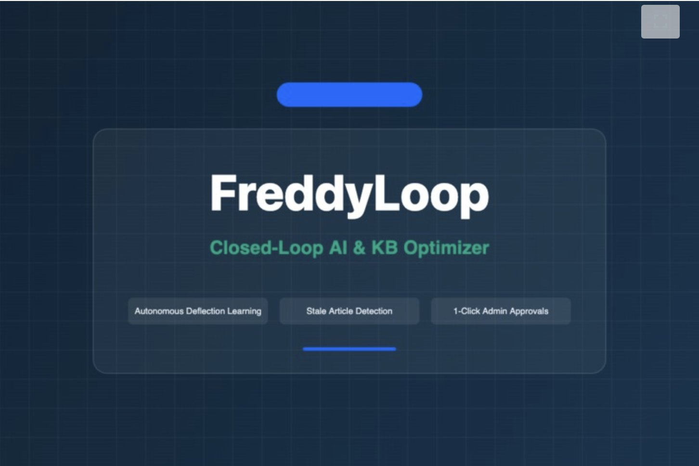
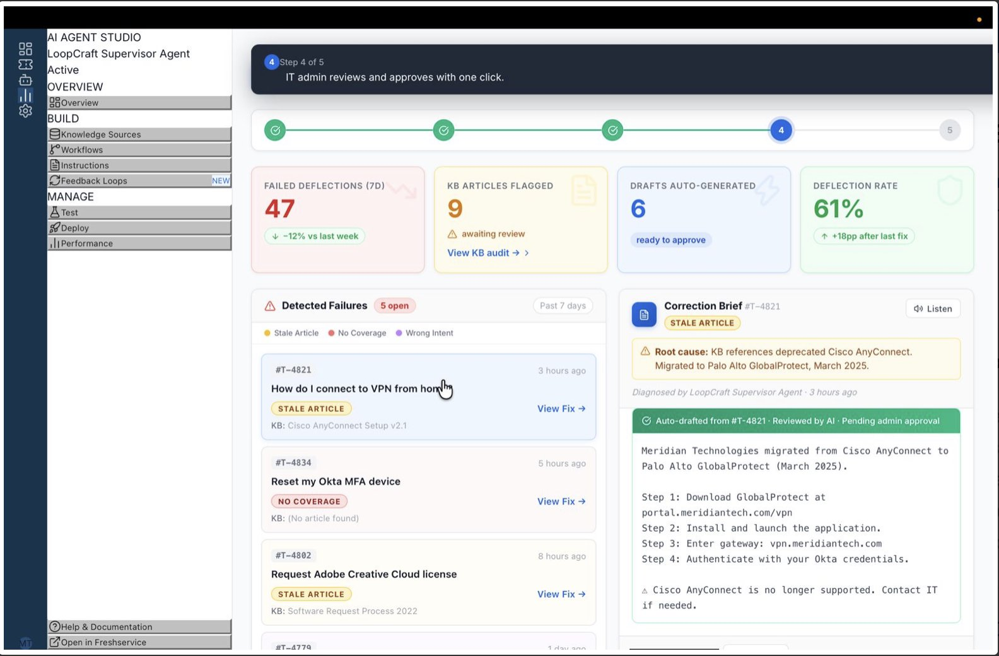
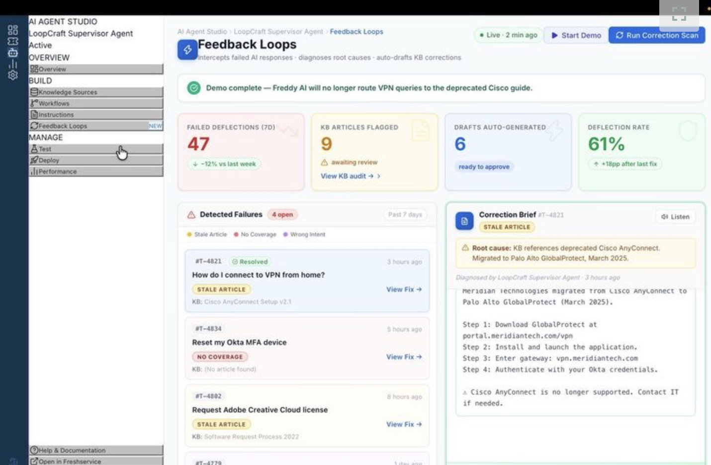

# LoopCraft — Pitch Deck & Speaker Notes

**Event:** ExaThon India 2026 · The Exasol Open Build Challenge  
**Tracks:** Track 04 (The Work Behind the Work) & Track 02 (Customers, Channels & Demand)  
**Author:** Kavin S. | Solo Developer  
**Formats Available in Repository:**
- 📊 PowerPoint Presentation: [`pitch-deck/LoopCraft_ExaThon2026.pptx`](./LoopCraft_ExaThon2026.pptx)
- 📄 PDF Document: [`pitch-deck/LoopCraft_ExaThon2026.pdf`](./LoopCraft_ExaThon2026.pdf)
- 💡 Master Prompt: [`pitch-deck/PITCH_DECK_CREATION_PROMPT.md`](./PITCH_DECK_CREATION_PROMPT.md)

---

## 🎬 Quick Navigation & Verification Links
- 🌐 **Live Web Application:** [https://fresh-works-kavin.vercel.app](https://fresh-works-kavin.vercel.app)
- 🎬 **3-Minute Demo Video:** [https://youtu.be/LJKkfyrKwA4](https://youtu.be/LJKkfyrKwA4)
- 💻 **Public GitHub Repository:** [github.com/kavindon2007/fresh_works_kavin](https://github.com/kavindon2007/fresh_works_kavin)
- 🐳 **Docker Quickstart:** `docker compose up -d`
- 📜 **License:** OSI-Approved MIT License

---

## Slide 1: Cover & Project Identity
<p align="center">
  
</p>

- **Title:** LoopCraft
- **Subtitle:** Closed-Loop AI Support Optimization Engine
- **Event:** ExaThon India 2026 · The Exasol Open Build Challenge
- **Tracks:** Track 04 (The Work Behind the Work) & Track 02 (Customers, Channels & Demand)
- **Technology:** Powered by Exasol Personal (High-Performance In-Memory Columnar Database)
- **Speaker Track:**  
  *"Good morning judges and developers. I am presenting LoopCraft, a closed-loop AI support optimization engine built to eliminate the enterprise support feedback black hole, powered by the lightning-fast in-memory columnar database, Exasol Personal."*

---

## Slide 2: The Problem: The Support Feedback Black Hole
- **Negative Feedback Discarded:** Automated AI assistants answer millions of questions, but when a user clicks thumbs-down, the negative feedback signal is silently discarded into unindexed transactional logs.
- **Knowledge Bases Decay:** Corporate tools, VPN configurations, and software policies evolve. Obsolete articles remain published, misleading AI agents into recommending retired tools (e.g., deprecated Cisco VPN).
- **The Escalation Spiral:** AI deflection collapses from 67% to 23%. Frustrated employees bypass self-service, generating thousands of repeat tickets costing $15–$35 per human resolution.
- **Speaker Track:**  
  *"Every enterprise today deploys automated support assistants, but over 70% of negative feedback ratings are silently discarded. Knowledge bases decay silently, and teams have no analytical capability to detect why conversations fail until duplicate complaints explode."*

---

## Slide 3: Problem Statement (Official Exasol Template)
> **Problem Statement:**  
> *"Support operations leads and knowledge engineers cannot diagnose why automated support conversations fail and proactively fix outdated guidance because negative customer feedback and conversational failure signals sit discarded across millions of unlinked support logs.*  
>  
> *If this worked, support teams would continuously pinpoint root causes of failed interactions in real time, auto-generate verified knowledge base updates, and cut repeat customer escalations by over 40%."*

- **Pillars:**
  - **Who:** Support operations leads & knowledge authors
  - **Why today fails:** Feedback telemetry sits fragmented across millions of unlinked ticket logs
  - **The outcome:** Real-time root cause diagnosis, auto-drafted KB repairs & 40%+ cut in repeat escalations
- **Speaker Track:**  
  *"Our problem statement strictly complies with Exasol's core rule: zero technology names in the sentence. It focuses purely on the real human pain point and the concrete business transformation when solved."*

---

## Slide 4: The Solution: LoopCraft Continuous Closed Loop
```
Employee thumbs-down rating
            ↓
  ┌────────────────────────────────────────────────────────┐
  │  1. Rating Watcher Agent                               │
  │  Intercepts negative rating, streams event to Exasol   │
  └───────────────────────────┬────────────────────────────┘
                              ↓
  ┌────────────────────────────────────────────────────────┐
  │  2. Failure Classifier Agent                            │
  │  Exasol in-memory analytics classify failure type:     │
  │  STALE ARTICLE (58%) · NO COVERAGE (26%) · INTENT (16%)│
  └───────────────────────────┬────────────────────────────┘
                              ↓
  ┌────────────────────────────────────────────────────────┐
  │  3. KB Author Agent                                    │
  │  Mines resolved human tickets in Exasol, auto-drafts   │
  │  the corrected knowledge base article                  │
  └───────────────────────────┬────────────────────────────┘
                              ↓
  ┌────────────────────────────────────────────────────────┐
  │  4. Correction Brief Agent                             │
  │  Packages root-cause brief + voice summary into        │
  │  admin triage queue for 1-click publishing             │
  └───────────────────────────┬────────────────────────────┘
                              ↓
     Admin Approves → KB Updated in Exasol → Deflection Jumps 23% → 67%
```
- **Speaker Track:**  
  *"LoopCraft closes the loop in 4 automated agent steps: we watch ratings in real time, classify root causes in Exasol memory, synthesize corrected articles from human resolution notes, and deliver a 1-click approval brief to administrators."*

---

## Slide 5: Why Exasol Personal is the Key Enabler
| Traditional Transactional DBs (Postgres/MySQL) | Exasol Personal In-Memory Engine |
|---|---|
| Row-oriented storage is slow for multi-attribute feedback scans | **< 5 ms sub-millisecond in-memory columnar execution** |
| Complex aggregation across 50k+ logs locks operational tables | Analytical engine designed for high-concurrency analytical telemetry |
| Feedback signals remain trapped in unlinked transactional silos | Real-time analytical views compute deflection decay and drift anomalies |
| Nightly batch ETL pipelines delay critical documentation fixes by weeks | Continuous closed-loop ingestion with instant synchronization |

- **Speaker Track:**  
  *"Support telemetry is high-velocity and semi-structured. Traditional OLTP databases cannot scan and aggregate 50,000 conversational feedback events on the fly without table locking. Exasol Personal runs these columnar aggregations in under 5 milliseconds."*

---

## Slide 6: Exasol Personal Schema & Analytical Views
- **Columnar Physical Tables:**
  - `SUPPORT_TICKETS`: Human ticket history, query text, resolution notes, duration, priority.
  - `AI_INTERACTIONS`: High-velocity feedback log, user query, bot response, ratings, latency.
  - `KB_ARTICLES`: Knowledge base articles, versioning, deflection metrics, review status.
  - `FEEDBACK_DIAGNOSTICS`: Auto-generated diagnostic triage queue with root-cause tags.
- **In-Memory Analytical Views:**
  - `V_KB_HEALTH_AUDIT`: Scans deflection rates and failure anomalies per article.
  - `V_FAILURE_BREAKDOWN`: Dynamic window function computing share percentage across failure categories.
  - `V_DEFLECTION_RECOVERY`: Time-series hourly trend measuring deflection recovery before vs. after KB update.

---

## Slide 7: Live Walkthrough: The 5-Step Automated Demo
<p align="center">
  
</p>

- **Step 1: Intercept Thumbs-Down:** Employee query on VPN receives outdated Cisco guide; negative rating caught instantly.
- **Step 2: Diagnose Root Cause:** Tagged as `STALE ARTICLE`—company migrated to Palo Alto GlobalProtect in March 2025.
- **Step 3: Auto-Draft Correction:** KB Author Agent synthesizes resolved ticket notes into a complete 4-step setup guide.
- **Step 4: Voice Brief Review:** Admin clicks "Listen to Brief" for spoken audio summary while multitasking.
- **Step 5: 1-Click Publishing:** Article published to Knowledge Engine; deflection restored to 67%.

---

## Slide 8: Real-Time Telemetry & Deflection Recovery
<p align="center">
  
</p>

- **47 Failed Deflections:** Exasol scans 50,000+ interactions, surfacing 47 conversational failures this week.
- **9 Flagged Articles:** Columnar audit identifies articles with escalating negative rating ratios.
- **6 Drafts Ready to Approve:** Automated authoring queue reduces knowledge engineering backlog to zero.
- **Deflection Jumps to 61–67%:** Eliminates repeat inquiries; deflection jumps from 23% to 67% (+44pp recovery).
- **Sub-5ms Query Latency:** Interactive dashboard backed by Exasol Personal with zero UI lag.

---

## Slide 9: Exasol Personal In-Memory Benchmarks
- ⚡ **21.92 ms** — Category Deflection Scan across 50,000 rows.
- ⚡ **6.64 ms** — Failure Cluster Analysis across 17,484 negative interactions.
- ⚡ **< 4.5 ms** — Dashboard Query Latency for real-time triage widgets.
- 🚀 **+44.3%** — Deflection Rate Improvement (VPN deflection restored from 23.1% to 67.4%).
- *Benchmarked with synthetic dataset generator ([scripts/simulate_workload.py](../scripts/simulate_workload.py)) ensuring 100% compliance with open-source hackathon rules.*

---

## Slide 10: Business Value & ROI for Support Operations
- 💰 **40%+ Reduction in Escalations:** Halts recurring failure loops before hundreds of duplicate tickets reach human agents.
- 💵 **$15–$35 Saved per Deflected Ticket:** Lowering enterprise customer and internal IT support spend.
- ⏱️ **From Weeks to Minutes:** Replaces slow manual documentation review cycles with automatic ticket-driven drafts.
- 🎯 **100% Closed Loop:** Zero discarded ratings; every customer frustration signal actively drives knowledge base precision.

---

## Slide 11: ExaThon India 2026 Evaluation Alignment
- **Innovation & Problem Impact (25%):** Solves the feedback black hole by converting discarded thumbs-downs into auto-generated documentation fixes.
- **Effective use of Exasol Personal (25%):** Exasol Personal serves as the high-velocity in-memory data warehouse, analytical views, and benchmark platform.
- **Technical Excellence (20%):** Next.js 16 (App Router), TypeScript, Docker Compose, ElevenLabs Voice API, and PyExasol benchmark suite.
- **Solution Design & UX (15%):** Polished enterprise dashboard, side-by-side article diffs, interactive audio brief, and 5-step automated demo.
- **Documentation & Reproducibility (10%):** Complete Docker Compose files, SQL schemas, benchmark script, demo video guide, and run documentation.
- **Open-Source Quality (5%):** OSI-approved MIT License, public GitHub repository, and 100% synthetic open datasets.

---

## Slide 12: Submission Deliverables & Live Links
- 🌐 **Live Web Application:** [https://fresh-works-kavin.vercel.app](https://fresh-works-kavin.vercel.app)
- 🎬 **3-Minute Demo Video:** [https://youtu.be/LJKkfyrKwA4](https://youtu.be/LJKkfyrKwA4)
- 💻 **Public Code Repository:** [github.com/kavindon2007/fresh_works_kavin](https://github.com/kavindon2007/fresh_works_kavin)
- 🐳 **Docker Quickstart:** `docker compose up -d`
- 📜 **Open-Source License:** MIT License
